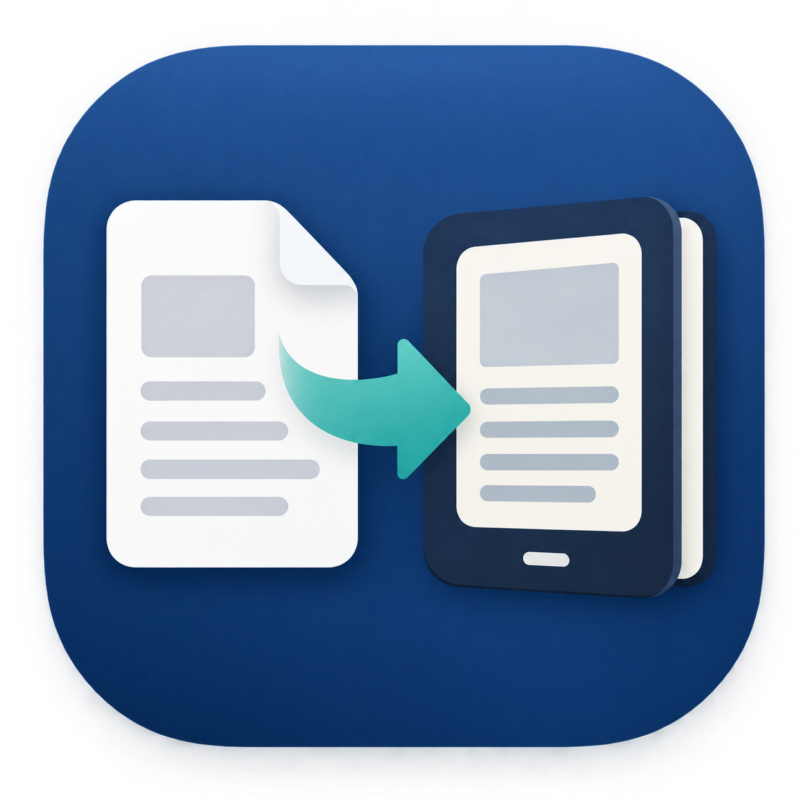

# PDF til Kindle



En lokal macOS-app, der omdanner PDF-filer til reflowable EPUB til **Send to Kindle**.

Vinduet tilpasser automatisk sin størrelse til de synlige indstillinger. AI-indstillingerne er samlet i kompakte, vandrette rækker, så handlingsknapperne og statusområdet normalt kan ses uden scrolling, også når AI er aktiveret. På meget små skærme fungerer scrolling stadig som reserve.

Appen følger automatisk macOS' lyse eller mørke udseende. Tekst, felter, statuskort, dropdownmenuer og deaktiverede kontroller skifter til et kontraststærkt farvesæt, også hvis systemets udseende ændres, mens appen er åben.

Under konverteringen deaktiveres alle indstillinger og handlingsknapper undtagen **Afbryd**. En fremhævet fasetekst skelner mellem lokal behandling, afventning af brugerens AI-godkendelse, behandling via OpenAI API og lokal opbygning af Kindle-filen. Den detaljerede status viser løbende side- eller tekstportionsnummer.

## Fejltolerance

- Midlertidige OpenAI-fejl, timeouts og rate limits forsøges automatisk igen op til seks gange. Efter de første hurtige genforsøg bruger appen længere, synlige pauser, så en kortvarig API- eller netværksforstyrrelse sent i en stor bog ikke straks sender resten over på lokal OCR.
- AI-tekst opdeles i korte portioner på cirka 3.500 tegn. Under hvert API-kald vises faktisk forløbet ventetid og aktuelt forsøg; det lokale ETA skjules. Efter første afsluttede AI-kald beregnes resterende AI-tid ud fra de målte svartider.
- Netværkskald kører i en separat afbrydelig tråd, så **Afbryd** reagerer med det samme i stedet for at vente på HTTP-timeout.
- Ventestatus indeholder altid den overordnede enhed, eksempelvis **Tekstportion 3 af 12** eller **Billedside 4 af 20**, så et nyt API-kald ikke ligner en nulstillet løkke. Hvert forsøg har en absolut grænse på 180 sekunder. Mellem forsøgene tæller status ned gennem pauser på normalt 2, 8, 30, 90 og 180 sekunder; en eventuel `Retry-After`-anvisning fra API'et respekteres, hvis den er længere.
- Alle transportgenforsøg for samme tekstportion bruger den samme idempotency-nøgle. Dermed kan appen sikkert prøve igen, hvis forbindelsen tabes efter afsendelsen, uden at et allerede modtaget kald bevidst oprettes som en ny opgave. Klient- og server-request-ID logges uden dokumenttekst eller API-nøgle, så vedvarende fejl kan spores.
- Opbrugt API-kvote, ugyldig nøgle, ugyldigt modelsvar eller vedvarende netværksfejl kasserer ikke OCR-arbejdet. Appen færdiggør automatisk en lokal EPUB og fortæller tydeligt, hvilken AI-del der blev sprunget over.
- AI-tekstkorrektioner bevares portionsvis. Hvis en senere portion fejler, beholdes rettelserne fra alle gennemførte portioner, mens kun den berørte portion falder tilbage til OCR-teksten.
- AI-svar til tekst og illustrationer kræves som strengt struktureret JSON efter et schema. Parseren kan desuden udtrække JSON, hvis en model alligevel tilføjer forklarende tekst omkring svaret.
- Ved AI-billedfejl fjernes de delvise AI-resultater, og den lokale illustrationsanalyse bruges som reserve.
- EPUB-output skrives og valideres under et midlertidigt navn og erstatter først destinationsfilen, når hele filen er gyldig.
- Forsøg på at lukke appen under behandling kræver bekræftelse og udløser kontrolleret afbrydelse.

Det diskrete tekstlink **Developer** øverst til højre åbner adgang til en roterende logfil under `~/Library/Logs/PDF til Kindle/`. **Åbn log** viser filen, mens **Kopiér diagnostik** samler systemversion, Python-version, valgte indstillinger og de seneste loglinjer. Loggen roterer ved 2 MB og gemmer højst tre ældre filer. API-nøgler, dokumenttekst og sidebilleder logges aldrig.

Under en konvertering starter appen macOS `caffeinate`, som forhindrer automatisk inaktivitetssleep, indtil processen er færdig eller afbrudt. Skærmen kan stadig slukke. Tvungen sleep, eksempelvis når låget lukkes, håndteres efter opvågning af API-timeout, retry og lokal fallback; EPUB-output erstattes fortsat kun atomisk efter validering.

## Start

1. Dobbeltklik på **PDF til Kindle.app** i projektmappen.
2. Vælg PDF, titel, forfatter og OCR-sprog.
3. Klik **Opret Kindle-fil…** og upload den færdige `.epub` via Send to Kindle.

Under konverteringen viser appen et løbende estimat for den resterende tid. Knappen **Afbryd** stopper den aktive PDF-rendering eller OCR-proces og rydder midlertidige filer op. Indstillingerne er låst, mens konverteringen kører.

Appen fjerner automatisk sidetal samt sidehoveder og sidefødder, der gentages på tværs af dokumentet.

Kindle-kapitler oprettes ud fra tydelige kapitelmarkører og OCR-typografi. Markører som **Kapitel 3**, **Del II** og nummererede titler genkendes direkte. En kort typografisk overskrift kan også starte et kapitel, når den står først på en side efter en passende mængde brødtekst. Almindelige PDF-sideskift opretter ikke længere kapitler.

Den valgfrie **AI-efterbehandling** sender OCR-teksten i mindre portioner til OpenAI Responses API. Modelmenuen hentes dynamisk ud fra de modeller, API-projektet har adgang til. Når OCR er færdig, viser appen estimerede inputtokens, outputtokens og samlet tokenforbrug og beder om godkendelse, før teksten sendes. Modellen instrueres i kun at rette tydelige OCR-fejl, orddeling, mellemrum og tegnsætning uden at forkorte, oversætte eller omskrive teksten. Funktionen er slået fra som standard og kræver en OpenAI API-nøgle. Nøglen kan gemmes sikkert i macOS-nøglering. API-forbrug afregnes separat af OpenAI og er ikke nødvendigvis inkluderet i et ChatGPT-abonnement.

Systeminstruktionerne, der sendes til OpenAI, er skrevet på engelsk for at være entydige på tværs af modeller. De kræver samtidig eksplicit, at dokumentets oprindelige sprog bevares, og at teksten aldrig oversættes eller omskrives.

**AI til illustrationer** kan vælges separat under AI-efterbehandling. Et lokalt filter udvælger først sider med sandsynlige illustrationer, og kun disse sidebilleder sendes til den valgte multimodale model. Modellen skelner illustrationer fra tekst, returnerer beskæringskoordinater og vælger den nærmeste OCR-tekstblok som placering. Beskæringen udføres derefter lokalt på den højopløste side. Dialogen før API-kaldet viser både antallet af sidebilleder og et konservativt tokenestimat.

AI-panelet er skjult, indtil **Brug AI til at forbedre resultatet** vælges. Her kan tekstkorrektur og billedanalyse slås til uafhængigt, modellen vælges, og arbejdsgangen sættes til enten **Spørg før afsendelse** eller **Send automatisk efter OCR**. Den nederste hjælpetekst forklarer den valgte model og viser tokenestimatet, når det er beregnet.

AI-integrationen er designet specifikt til OpenAI API. Den kræver en OpenAI API-nøgle, og API-forbrug afregnes separat fra et ChatGPT-abonnement; dette fremgår også direkte i appens AI-panel.

Knappen **Opdatér modeller** henter først API-projektets aktuelle modeladgang. Et lille baggrundskald vælger derefter tre relevante modeller og søger kun i officiel OpenAI-dokumentation efter beskrivelser og standardpriser. Der ligger ingen modelnavne, beskrivelser eller priser hardcoded i appen. En pris vises kun, når metadata-kaldet kan bekræfte den; ellers står der **Pris ukendt**. Resultatet gemmes lokalt og genbruges mellem appstarter. Appen foretager kun en ny model- og metadataforespørgsel, når brugeren selv trykker **Opdatér modeller**. Ved **Spørg før afsendelse** vises det samlede tokenestimat én gang samt de tre anbefalinger med profil, begrundelse og estimeret pris. Ved automatisk afsendelse bruges modelvalget fra hovedvinduet.

API-nøglen kan gemmes i macOS-nøglering og indlæses automatisk ved næste opstart. Den gemmes aldrig i projektfiler eller logfiler og kan fjernes igen med **Glem nøgle**. HTTPS-kald bruger macOS' verificerede CA-certifikatbundle (med `certifi` som reserve); SSL-verifikation deaktiveres aldrig.

Hvis macOS blokerer appen første gang, så højreklik på den og vælg **Åbn**. `start.command` kan bruges som reserve.

App-pakken indeholder sin egen kopi af programkoden, så macOS ikke behøver at give launcheren særskilt adgang til filer uden for appen. Hvis kildekoden ændres, kan app-pakken opdateres ved at køre `./build_app.command`.

Alternativt fra Terminal:

```bash
python3 app.py
```

## Krav

- Python 3 med Tkinter og Pillow
- Poppler (`pdftoppm`)
- Tesseract OCR

Appen tilbyder dansk, engelsk, tysk, fransk, spansk, norsk og svensk. Når brugeren vælger et sprog, der mangler lokalt, hentes den officielle `tessdata_fast`-model med det samme. Statuslinjen og fremdriftsbjælken viser downloadstatus. Modellen gemmes i appen og genbruges næste gang.

Appen gemmer ikke eller sender dokumenter online. Den laver OCR lokalt. Tekstens blokke, overskrifter, lister og indryk rekonstrueres ud fra OCR-koordinaterne. Fotos, diagrammer og andre tætte områder uden tekst udskæres og placeres i læserækkefølgen mellem tekstblokkene.

## Begrænsninger i første version

- Tabeller, fodnoter og tekst i flere spalter kan kræve manuel efterbehandling.
- Meget dekorative sider og illustrationer med tekst oven på billedet kan stadig kræve manuel efterbehandling.
- Håndskrift og meget dårlige scanninger afhænger af Tesseracts OCR-kvalitet.
